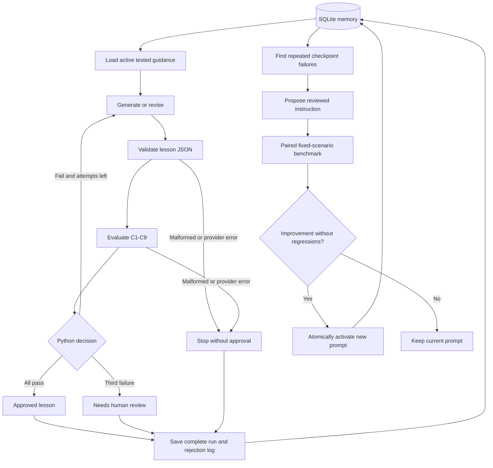

# Design and decisions

## Problem and audience

A Class 12 graduate in India with limited English should finish a standalone RAG lesson understanding what it is, why it helps, how it works, and why it can still be wrong. A fluent answer is not enough: the system must decide whether each required teaching condition was met and preserve evidence of failures and corrections.

## Planning and implementation order

1. Define learner goals, a reviewed source pack, a structured lesson, and a binary rubric.
2. Validate generation independently of any workflow framework.
3. Add a separate structured evaluator and deliberate-error tests.
4. Add bounded generation/evaluation/revision orchestration and actual-text change logs.
5. Add durable run/feedback memory and versioned prompt improvement.
6. Verify no-cost tests and live behavior, then prepare the final lesson and demonstration evidence.

## Architecture

The graph has generation, evaluation, and finish nodes. Provider clients are dependency-injected closures; state contains only Pydantic-validated brief/attempt/result data. Conditional routes contain no model calls. Generation and evaluation failures terminate, while content failures can revise. The cap is a constant (three total attempts) plus a graph recursion limit. Seeded error demos use the same cap.

## Why this stack

- **LangGraph:** makes the loop and stopping edges explicit and testable. A free-form agent choosing arbitrary tools is unnecessary.
- **Pydantic:** rejects malformed lessons and evaluations before routing or approval.
- **Gemini:** one provider integration with structured JSON output and explicit call budgets. Writer/reviewer prompts are separate; another reviewer model could be substituted later.
- **SQLite:** sufficient for durable local history without a hosted database. Version lineage and experiment reports are inspectable.
- **Streamlit:** exposes the workflow for the video without maintaining a separate frontend/API stack.
- **uv:** one dependency workflow with a committed lockfile; no pip-based setup.

## Rubric

Every item is pass/fail; all parts of the condition must be met. C1 definition; C2 need for external information; C3 preparation/retrieval/generation; C4 question/source/answer example; C5 defined essential terminology; C6 retrieval and generation limitations; C7 factual support against references; C8 useful exercise and correct explanation; C9 beginner-accessible teaching order and language.

The evaluator must return exactly C1-C9 once each, strict JSON booleans, evidence, a reason, and correction instructions. Missing/duplicate/unknown checks, string booleans, or model-supplied overall approval fields are rejected. Python computes approval. The lesson is treated as content, not evaluator instructions. Invalid output is not equivalent to passing and is not silently replaced by fabricated results.

The rubric was strengthened during development after a live draft passed despite an unsupported instant-update claim and potentially unexplained terms. The new reference notes cover document syncing and errors with correct sources; rubric version `rag-v2` makes this change explicit. This development correction is separate from the implemented cross-run prompt-learning mechanism. The system never weakens the rubric to boost pass rate.

## Rejection and change evidence

Each attempt stores its complete lesson and evaluation. Failures record the excerpt, reason, and requested correction. The following attempt records every section whose actual text changed. The full versions are retained, so a reviewer can compare them rather than trust a model's self-reported “fixed” claim. Reevaluation establishes whether the rubric now passes. Infrastructure errors retain earlier attempts and stop without approval.

## Memory and evolution

SQLite records runs and source/brief snapshots, full attempts, evaluator results, model names, prompt lineage, feedback, candidate provenance, and benchmark outcomes. No API key or raw provider exception is saved. Prompt versions represent additional teaching guidance; the source writer prompt also has its own code-level version in the brief.

The analysis counts a failed checkpoint once per normal run, across attempts and feedback. It excludes seeded demonstrations and old-rubric model failures. After two distinct runs, it chooses a relevant teaching strategy from a reviewed catalog. The proposed instruction is appended to the active instruction set and deduplicated by parent and checkpoint.

Adoption uses fresh baseline/candidate drafts on the same two fixed scenarios and an unchanged evaluator. Eight calls maximum; no workflow retries inside benchmarks. The target and total failures must decrease, with zero observed per-check regressions. Parent comparison during a SQLite write transaction prevents stale experiments replacing newer guidance. Failed/negative experiments remain visible and do not change future prompts.

This is a conservative form of self-evolution with explicit experimentation cost, not model fine-tuning. A small noisy benchmark can still select an instruction that does not generalize; held-out learner trials and more diverse benchmark topics would be the next evaluation step. There is no claim that the system has demonstrated an improvement until an actual experiment is accepted.

## Security, reliability, and scope

The app is local and single-user. It reads `.env` without changing process variables and uses the JSON Schema field supported by Gemini. Credentials and database files are gitignored. Ordinary tests use isolated local databases and fake responses; live runs require `--live` at the CLI or explicit UI actions. No email, business action, or automatic external publication is involved.

Reference notes are curated summaries with source links, not full web retrieval. All live judgments remain fallible. The specific false-guarantee Python safeguard is disclosed in the demo; an independent live model check also rejected the claim during development. The workflow's approval is rubric approval, not proof that a learner understood the content.
